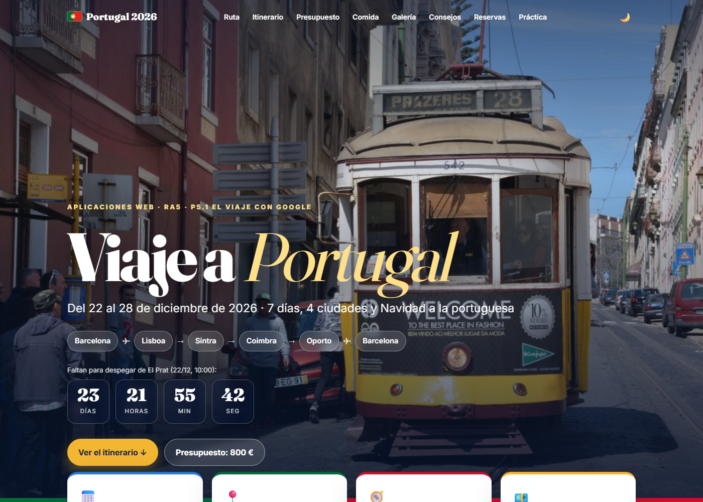

# P5.1 · El viaje con Google — Portugal 

**Alumno:** Daniel Martin Marrupe 

**Cuenta:** dmartin@elpuig.xeill.net

**Compañero de pruebas:** vmartinez@elpuig.xeill.net

**Módulo:** 0228 Aplicaciones Web RA5

**[Carpeta del proyecto](https://drive.google.com/drive/folders/1k93L7iVusqR1FFJSyKd43hvzHzU6Qxd-?usp=sharing)**

**[Calendario](https://calendar.google.com/calendar/u/0?cid=Y19lNmJlYjU3YTQ1YTY3OTZlMTM3MGU3OTIzOWUxYjQ0MWJmOTU5YjQ3ZTFhNmFlMDBiMWUxNDI5NzllMTA4MTBmQGdyb3VwLmNhbGVuZGFyLmdvb2dsZS5jb20)**


---

## Fase 1: El correo

### 1. Seis herramientas de Google

| Herramienta | Propósito | Público (target) |
|---|---|---|
| **Gmail** | Enviar, recibir y organizar el correo electrónico con etiquetas, filtros y respuestas automáticas. | Particulares, estudiantes y empresas. |
| **Google Calendar** | Organizar eventos y citas, invitar a otras personas, poner recordatorios y compartir calendarios. | Estudiantes, profesores y equipos de trabajo. |
| **Google Maps** | Consultar mapas, calcular rutas y crear mapas propios con paradas (por ejemplo, la ruta de un viaje). | Cualquier persona que viaje o se desplace. |
| **Google Sheets** | Hojas de cálculo en línea con fórmulas, gráficos y edición en tiempo real entre varias personas. | Estudiantes, empresas y quien necesite hacer cálculos o presupuestos. |
| **Google Drive** | Guardar archivos en la nube y compartirlos con permisos (ver, comentar o editar). | Particulares, centros educativos y empresas. |
| **Google Meet** | Hacer videollamadas y reuniones en línea, compartiendo la pantalla. | Equipos de trabajo, profesores y alumnos. |

### 2. Diferencia entre IMAP y POP3

**IMAP** deja los correos en el servidor y los sincroniza: si lees, borras o mueves un correo en el móvil, el cambio también se ve en el ordenador y en la web.
**POP3** descarga los correos a un solo dispositivo y normalmente los borra del servidor, así que no se sincronizan entre dispositivos.
IMAP va mejor si usas varios dispositivos. POP3 sirve si solo usas uno o quieres tener los correos guardados en local.
Puertos seguros: IMAP 993 (SSL) y POP3 995 (SSL).

### 3. Etiqueta "institut" (verde)


### 4. Cinco filtros

| # | Criterio | Acción |
|---|---|---|
| 1 | Contiene `puig` | Aplicar la etiqueta **institut** |
| 2 | Contiene `publicitat` | Saltar Recibidos y categorizar como **Promociones** |
| 3 | De `rusben@elpuig.xeill.net` | Marcar como **importante** |
| 4 | De `caridadcastillo@elpuig.xeill.net` | Marcar como **importante** |
| 5 | De `vmartinez@elpuig.xeill.net` | **Destacar**  |


### 5. Respuesta automática de vacaciones

Mensaje: **"Estoy de Vacaciones"**  Solo se envía a usuarios de elpuig.xeill.net.


---

## Fase 2: Comprobar el acceso

### 1. Acceso IMAP

En **Configuración → Reenvío y correo POP/IMAP** aparece el apartado **Acceso IMAP** con todas sus opciones. Ahora Gmail tiene IMAP **siempre activado** y ya no deja desactivarlo, así que el acceso IMAP está activo.


**Parámetros de cada servicio (Gmail / Google Workspace):**

| Servicio | Servidor | Puerto | Seguridad | ¿Requiere autenticación? |
|---|---|---|---|---|
| IMAP (recibir) | `imap.gmail.com` | 993 | SSL/TLS | Sí (correo completo + contraseña o contraseña de aplicación) |
| POP3 (recibir) | `pop.gmail.com` | 995 | SSL/TLS | Sí |
| SMTP (enviar) | `smtp.gmail.com` | 465 / 587 | SSL / STARTTLS | Sí |

### 2–3. Prueba entre dos cuentas

Con dos sesiones abiertas (la mía, **dmartin**, en mi ordenador y la de **vmartinez** en el suyo):

1. **vmartinez me envía** un correo con el asunto **"Prova filtre puig"**. Me llega con la etiqueta verde **institut** (filtro 1, porque contiene "puig") y con la **⭐** (filtro 5, porque lo envía vmartinez).


2. A vmartinez **le llega mi respuesta automática** de vacaciones.


3. **Le respondo** y mi respuesta le llega en la **misma conversación**.


### 5. Lista de pruebas: correo

| # | Prueba | Resultado esperado | Resultado obtenido |
|---|---|---|---|
| 1 | La etiqueta "institut" existe | Sale en la columna de la izquierda, de color verde |  Correcto |
| 2 | Filtro 1: un correo que contiene "puig" | Le pone la etiqueta "institut" |  Correcto (el correo de Moodle del Institut Puig Castellar tiene la etiqueta) |
| 3 | vmartinez envía "Prova filtre puig" | Llega con la etiqueta "institut" |  Correcto |
| 4 | Filtro 2: un correo que contiene "publicitat" | No pasa por Recibidos y va a Promociones |  Correcto: "Oferta publicidad" de vmartinez (el texto dice "publicitat") no sale en Recibidos y está en Promociones. También lleva "institut" y la  (filtros 1 y 5) |
| 5 | Filtro 3: un correo de rusben@elpuig.xeill.net | Se marca como importante |  Correcto: los 3 correos de rusben tienen el marcador de importancia |
| 6 | Filtro 4: un correo de caridadcastillo@elpuig.xeill.net | Se marca como importante |  Correcto: los 11 correos de la tutora tienen el marcador de importancia |
| 7 | Filtro 5: un correo de vmartinez@elpuig.xeill.net | Se destaca con una  |  Correcto |
| 8 | Respuesta automática activada | Arriba de Gmail sale la barra amarilla "Vacaciones" |  Correcto |
| 9 | vmartinez me escribe | Le llega la respuesta automática de vacaciones |  Correcto: le llega "Estoy de Vacaciones" |
| 10 | Respondo al correo de vmartinez | Le llega mi respuesta en la misma conversación |  Correcto |
| 11 | Comprobar el acceso IMAP | En Configuración sale el apartado "Acceso IMAP" |  Correcto |
| 12 | Ver el original de un correo | Salen SPF, DKIM y DMARC |  Correcto (SPF PASS, DKIM PASS, DMARC FAIL) |


### 4. Original de un mensaje: SPF, DKIM y DMARC

He abierto **"Mostrar original"** del correo *"Moodle de l'Institut Puig Castellar: Compte d'usuari nou"*.


| Comprobación | Resultado | Qué es |
|---|---|---|
| **SPF** (Sender Policy Framework) |  PASS con la IP 54.240.4.3 | Un registro DNS del dominio que dice **qué servidores (IP) pueden enviar correo** en su nombre. El servidor que recibe el correo comprueba si la IP de quien lo envía está en esa lista. |
| **DKIM** (DomainKeys Identified Mail) |  PASS con el dominio amazonses.com | El servidor que envía **firma el correo con una clave privada**, y quien lo recibe comprueba la firma con la clave pública publicada en el DNS. Así se sabe que el mensaje **no se ha modificado** por el camino. |
| **DMARC** (Domain-based Message Authentication, Reporting and Conformance) |  FAIL | Una política DNS que exige que el dominio del **"De:"** visible **coincida (esté alineado)** con el dominio que ha pasado SPF o DKIM. También dice qué hacer si falla (`none`, `quarantine` o `reject`). |

**¿Por qué falla DMARC si SPF y DKIM pasan?** El correo lo envía Moodle a través de **Amazon SES**. SPF y DKIM se validan con el dominio de Amazon (`amazonses.com`), pero en el campo **"De:"** pone `noreply@newmoodle.elpuig.xeill.net`. Como los dominios **no coinciden**, DMARC falla. Aun así, el correo ha llegado a la bandeja de entrada porque la política DMARC del dominio no manda rechazarlo. Para arreglarlo, el instituto tendría que configurar Amazon SES para firmar con DKIM usando su propio dominio (`elpuig.xeill.net`).

## Fase 3: El viaje

### 1. Ruta en Google Maps

**[Enlace al mapa](https://www.google.com/maps/d/edit?mid=145A6VuzUpB4-RtovZv1PJ7c_u61YdXY&usp=sharing)**


| Día | Ruta | Transporte | Dónde se duerme |
|---|---|---|---|
| 1 | Barcelona → **Lisboa** |  Avión | Lisboa |
| 2 | Lisboa (Alfama, Belém) |  Tranvía | Lisboa |
| 3 | Lisboa → **Sintra** → Lisboa |  Tren | Lisboa |
| 4 | Lisboa → **Coimbra** |  Tren | Coimbra |
| 5 | Coimbra → **Oporto** |  Tren | Oporto |
| 6 | Oporto (Ribeira, bodegas) |  A pie | Oporto |
| 7 | Oporto → **Barcelona** |  Avión | Casa |

El mapa tiene dos capas: **Paradas** (6 puntos) y **Trayectos** (5 líneas, cada una con su día y su transporte). La ruta **vuelve al punto de salida** (Barcelona).


### 2. Presupuesto en Google Sheets

 **[Enlace a la hoja](https://docs.google.com/spreadsheets/d/1DX9Zfmc3x8qNh0Wra62YNPtVeDOB9kaXfz4WBje3BJk/edit?usp=drive_link)**
 
 **[Carpeta de Drive](https://drive.google.com/drive/folders/1k93L7iVusqR1FFJSyKd43hvzHzU6Qxd-)**

| Categoría | Total |
|---|---|
| Transporte | 225 € |
| Alojamiento | 295 € |
| Comida | 280 € |
| **TOTAL** | **800 €** (sobran 700 €) |

Cada fila calcula su total con `=C*D`. Los subtotales se calculan con `SUMIF` / `SUMAR.SI`, y el total con `SUMA`.


#### Explicación de la fórmula `IF` (`SI` en castellano)

```
=SI(E16<=1500;"Dentro del presupuesto";"T'has passat")
```

`IF` tiene tres partes, separadas por `;` (en la configuración regional española el separador es el punto y coma, no la coma):

1. **Condición**: `E16<=1500` → ¿el total (celda E16) es menor o igual a 1.500 €?
2. **Valor si es cierto**: `"Dentro del presupuesto"`
3. **Valor si es falso**: `"T'has passat"`

Como el total es 800 €, la celda muestra **"Dentro del presupuesto"**. Si cambiara algún precio y el total pasara de 1.500 €, la celda cambiaría sola a "T'has passat".

### 3. Compartir la hoja con el profesorado

He compartido la carpeta **RA5 Viaje Portugal** (que contiene la hoja) con **rusben@elpuig.xeill.net** con el permiso **Comentador**, porque es el que pidió el profesor. Con este permiso puede **ver** la hoja y dejar comentarios, pero **no puede modificar** los datos. El acceso general es **Restringido**.


#### ¿Qué diferencia hay entre compartir con «cualquiera que tenga el enlace» y con personas concretas?

- **Cualquiera que tenga el enlace**: lo puede abrir **cualquier persona** que consiga el enlace, aunque no la conozcas (por ejemplo, si alguien lo reenvía o lo publica). No sabes quién lo abre y no puedes quitarle el acceso a una persona concreta.
- **Personas concretas**: solo pueden entrar las cuentas que añades una a una, y tienen que iniciar sesión con esa cuenta. Puedes dar a cada una un permiso diferente (Lector, Comentador o Editor) y quitárselo cuando quieras.

**He elegido personas concretas** porque el presupuesto es un documento privado y solo lo necesita ver el profesor. Así controlo quién tiene acceso y, si el enlace llega a otra persona, no lo podrá abrir.

En cambio, el **mapa del viaje** está compartido con «cualquiera que tenga el enlace» (solo lectura), porque está en mi cuenta personal y es la única forma de que el profesor lo pueda abrir desde la cuenta del instituto. Además, no contiene datos sensibles.

### 4. Calendario `CALENDARI_DANIEL_MARTIN_MARRUPE`

Calendario creado en la cuenta del instituto (organización elpuig.xeill.net), con zona horaria de Madrid.


**Fecha de inicio y de final:** un evento de todo el día, **"Viaje a Portugal (22-28 dic)"**, que va del **22/12/2026 al 28/12/2026**. Además hay **un evento cada día**, con su lugar y sus actividades:

| Fecha | Evento | Lugar | Actividades |
|---|---|---|---|
| Mar 22/12 | Día 1 · Vuelo Barcelona → Lisboa | Aeropuerto de Barcelona-El Prat | Vuelo a las 10:00, check-in en el hostal, Baixa y Praça do Comércio |
| Mié 23/12 | Día 2 · Lisboa: Alfama y Belém | Lisboa | Tranvía 28, Castelo de São Jorge, Torre de Belém, Jerónimos |
| Jue 24/12 | Día 3 · Excursión a Sintra | Sintra | Tren desde Rossio, Palacio da Pena, Quinta da Regaleira |
| Vie 25/12 | Día 4 · Tren Lisboa → Coimbra | Coimbra | Tren a las 10:00, ciudad vieja y universidad |
| Sáb 26/12 | Día 5 · Tren Coimbra → Oporto | Oporto | Livraria Lello, Torre dos Clérigos, São Bento |
| Dom 27/12 | Día 6 · Oporto: Ribeira y bodegas | Ribeira, Oporto | Puente Don Luis I y bodegas de Vila Nova de Gaia |
| Lun 28/12 | Día 7 · Vuelo Oporto → Barcelona | Aeropuerto Francisco Sá Carneiro | Mercado do Bolhão y vuelo a las 16:00 |


### 5. Prestaciones del calendario

**Evento que se repite y tiene final:** "Llamar a casa ", **cada día** a las 21:00, **hasta el 28/12/2026**.


**Recordatorios:** el vuelo de ida tiene una notificación **1 hora antes**, otra **1 día antes** y un **correo electrónico 2 horas antes**.


**Invitado:** he invitado a **vmartinez@elpuig.xeill.net** al evento del Día 6 (Oporto).


vmartinez recibe la invitación y responde **"Sí"**. En mi evento sale **"1 sí"** con un ✓ verde al lado de su nombre:


### 6. Lista de tareas: reservas

Lista **"Reservas viaje Portugal"** en Google Tasks, con 8 tareas y su fecha límite:

| Tarea | Fecha límite |
|---|---|
| Reservar vuelo Barcelona → Lisboa | 25/11/2026 |
| Reservar vuelo Oporto → Barcelona | 25/11/2026 |
| Reservar hostal Lisboa (3 noches) | 01/12/2026 |
| Reservar hostal Coimbra (1 noche) | 01/12/2026 |
| Reservar hostal Oporto (2 noches) | 01/12/2026 |
| Comprar billetes de tren Lisboa → Coimbra → Oporto | 10/12/2026 |
| Comprar entradas del Palacio da Pena (Sintra) | 15/12/2026 |
| Hacer check-in online del vuelo de ida | 21/12/2026 |


### 7. Calendario compartido

| Persona | Permiso |
|---|---|
| Daniel Martin Marrupe (yo) | Propietario |
| Victor Martinez Barbudo (vmartinez@elpuig.xeill.net), compañero | **Ver todos los detalles de los eventos** |
| Rubén Arroyo (rusben@elpuig.xeill.net), profesor | **Ver todos los detalles de los eventos** |


**Calendario visto desde la cuenta de vmartinez:** le sale CALENDARI_DANIEL_MARTIN_MARRUPE en "Otros calendarios", con todos los eventos del viaje (en catalán, porque tiene Calendar en ese idioma):


## Fase 4: Permisos y pruebas

### 1. Quién tiene acceso

| Recurso | Quién tiene acceso | Permiso | ¿Hace falta? |
|---|---|---|---|
| Hoja del presupuesto (carpeta de Drive) | rusben@elpuig.xeill.net | Comentador |  Sí, el profesor tiene que verla |
| Hoja del presupuesto | Acceso general | Restringido |  Nadie más puede abrirla |
| Calendario | vmartinez@elpuig.xeill.net | Ver todos los detalles |  Sí, lo pide la práctica |
| Calendario | rusben@elpuig.xeill.net | Ver todos los detalles |  Sí, para que el profesor pueda revisarlo |
| Mapa (cuenta personal) | Cualquiera con el enlace | Solo ver |  Es la única forma de que lo abran desde la cuenta del instituto |

He revisado los permisos y no hay ninguno que sobre: nadie tiene permiso de edición excepto yo.

### 2. Verificación en dos pasos

He comprobado en **myaccount.google.com → Seguridad → Cómo inicias sesión en Google** que la verificación en dos pasos está **desactivada** en la cuenta del instituto.


**¿Por qué no la he activado?** Con la verificación en dos pasos, cada vez que inicio sesión en un ordenador nuevo tengo que confirmar el acceso con el **móvil**. En el instituto **el móvil está prohibido**, y los ordenadores del aula se usan cada día, así que no podría iniciar sesión en clase.

Aun así, sé que es una medida de seguridad muy recomendable: aunque alguien robe la contraseña, no puede entrar sin el segundo factor (el código del móvil, una llave de seguridad o un aviso en el teléfono). Por eso **en mi cuenta personal sí la tengo activada**. Para la cuenta del instituto, la alternativa sin móvil serían los **códigos de seguridad de un solo uso**, impresos en papel.

### 3. Lista de pruebas: calendario, tareas, permisos y ruta

Prueba de la fórmula IF superando el presupuesto (prueba nº 14):


| # | Prueba | Resultado esperado | Resultado obtenido |
|---|---|---|---|
| 1 | Abrir el calendario CALENDARI_DANIEL_MARTIN_MARRUPE | Sale en "Mis calendarios" con este nombre exacto |  Correcto |
| 2 | Ver la semana del 22 al 28/12/2026 | Hay un evento cada día y la barra "Viaje a Portugal" del 22 al 28 |  Correcto |
| 3 | Abrir un evento del viaje | Tiene lugar y descripción con las actividades |  Correcto |
| 4 | Evento repetido "Llamar a casa" | Sale cada día del 22 al 28 y **no** sale el 29 |  Correcto: sale a las 21:00 del 22 al 28 y el 29 ya no aparece |
| 5 | Recordatorio del vuelo de ida | Tiene una notificación 1 hora antes, otra 1 día antes y un correo 2 horas antes |  Correcto |
| 6 | Invitar a vmartinez al evento del Día 6 | Le llega la invitación y yo veo "1 en espera" |  Correcto |
| 7 | vmartinez responde "Sí" a la invitación | En el evento sale como "Asistirá" y me llega un correo con su respuesta |  Correcto: sale "1 sí" con un ✓ verde |
| 8 | Lista de tareas "Reservas viaje Portugal" | Tiene 8 tareas con fecha límite |  Correcto |
| 9 | Las tareas salen en el calendario | Cada tarea sale el día de su fecha límite |  Correcto: salen como "Vencimiento" los días 1, 10, 15 y 21 de diciembre |
| 10 | Compartir el calendario con vmartinez | Tiene el permiso "Ver todos los detalles" |  Correcto |
| 11 | vmartinez abre mi calendario desde su cuenta | Ve los eventos con todos los detalles, pero no los puede editar |  Correcto: le salen todos los eventos del 22 al 28 en su calendario |
| 12 | Permisos de la hoja del presupuesto | Solo rusben como Comentador; acceso general Restringido |  Correcto |
| 13 | Abrir el enlace de la hoja en incógnito, sin cuenta | No se ve la hoja: pide iniciar sesión o sale "Necesitas acceso" |  Correcto: redirige a la pantalla de inicio de sesión de Google y no se ve ningún dato |
| 14 | Cambiar un precio para que el total pase de 1.500 € | La celda IF cambia a "T'has passat" |  Correcto: con la comida a 200 € el total sube a 1.920 € y sale "T'has passat". Después he vuelto a dejar 40 € |
| 15 | Abrir el enlace del mapa en una ventana de incógnito | Se ve la ruta sin poder editarla |  Correcto: en incógnito y sin iniciar sesión se ven las dos capas y no hay herramientas de edición |
| 16 | La ruta dura 7 días y vuelve al punto de salida | Barcelona → … → Barcelona |  Correcto |
| 17 | Verificación en dos pasos | Comprobar su estado |  Comprobado: desactivada (justificado en el apartado anterior) |


## Para subir nota: itinerario en HTML (GitHub Pages)

He creado una página web con el itinerario del viaje, publicada con GitHub Pages. **Haz clic en la imagen para abrirla:**

[](https://dmartin-elpuig.github.io/RA5-Viaje-Portugal/)

### 🌐 [Abrir la página del viaje a Portugal](https://dmartin-elpuig.github.io/RA5-Viaje-Portugal/)
